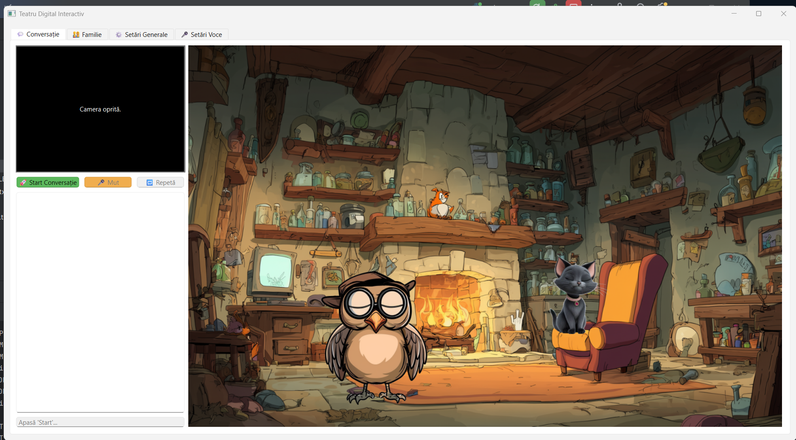

# 🦉 Cucuvel & Rina: an AI puppet theatre for children

Two animated characters, **Professor Cucuvel** the owl and **Rina** the cat, who **see, hear and recognise** the child in front of the screen, talk naturally with them, take them to school, tell stories and translate into nine languages.

Built for my own family: my nephew was Cucuvel's first student.



**Tech:** Python · PySide6 · Google Gemini (multimodal) · SpeechBrain ECAPA-TDNN · Silero VAD · Edge TTS · OpenCV · PyTorch · ~9,000 lines

---

## ✨ What it does

| The child says | The characters do |
|---|---|
| *"Cucuvel, let's go to school!"* | both walk to the classroom; the lesson continues where it stopped |
| *"Rina, how do you say 'apple' in Greek?"* | Rina answers, with phonetic subtitles and audio |
| *"I want to learn colours!"* | teacher mode: questions, drawings on the blackboard, answers checked by the AI |
| *(just talks into the microphone)* | voice activity detection, speaker identification, a reply in the character's own voice |

### 👀 They see, hear and recognise you
- **Camera:** Gemini looks at the frame and recognises family members from their descriptions; the characters' **gaze follows** whoever is talking.
- **Voice:** neural **voice activity detection** (Silero VAD), echo cancellation, automatic microphone calibration.
- **Who is speaking:** each family member records a short **voice print** (SpeechBrain ECAPA-TDNN); the characters know whether the child or a parent is talking.

### 🎭 A living stage
- **Scenes:** home by the fireplace, school, meadow, old school. Characters **teleport** between them, can be **summoned** or **sent** elsewhere.
- **Animation:** layered sprites that breathe, blink and change expression with the conversation (`[EMOTION:happy]`, `curious`, `confused`…).
- **Voices:** every sentence is synthesised and played while the next one is being generated, so the characters answer without long pauses; optional filler sounds.

### 📚 A personal teacher
- **6 curriculum domains, 54 levels:** pre-school preparation, first grade general knowledge, "Mind gymnastics", the same course **without the letter R** (for children who cannot pronounce it yet), "My world" (child development) and a Greek language course.
- A **blackboard** with nearly 300 illustrations for the lessons.
- **Progress per child:** each family member has their own level and completed questions; failed questions come back; a break is offered between levels.
- Every conversation and lesson is logged locally for the parents.

### 🌍 Rina translates
Besides Romanian, Rina speaks English, German, French, Italian, Spanish, Russian, Greek, Japanese and Korean, each with its own native voice, and shows subtitles in phonetic form so a child can repeat after her.

---

## 🛠️ Architecture

```
main_app.py               the application: UI, conversation loop, voice, camera, lessons
paths.py                  where family data lives (../Data)
managers/
  scene_manager.py        scenes and who is on stage
  character_manager.py    discovers character packages
characters/
  base_character.py       a character = config.json + sprite layers + prompts + voices
  animators.py            breathing, blinking, emotions, gestures
  cucuvel_owl/, rina_cat/ the two character packages
curriculum/<domain>/      curriculum.json + one prompt per level
scenes/scene_configs.json the four scenes
assets/                   blackboard illustrations, fonts, UI
tools/                    helpers used while building the content (frame extraction,
                          voice line generation, Gemini latency benchmark…)
```

A new character is a new folder in `characters/` with its own `config.json`, sprite layers, personality prompt and pre-recorded lines. No code changes are needed.

---

## 🔒 Family data stays at home

```
<root>/
├── Project/   this repository
└── Data/      family.json (members, ages, progress), voice_profiles/,
               conversation_logs/, config.json, .env, models/, temp/
```

- Nothing about the family is stored in the code folder; `.gitignore` refuses it a second time.
- Voice prints are numeric embeddings, not recordings.
- **What leaves the computer:** camera frames and the conversation go to Google Gemini; text to speak goes to Microsoft Edge TTS. Use it with that in mind.
- Set `TEATRU_DATA_DIR` to keep the data folder elsewhere.

---

## 🚀 Getting started

Windows 10/11, Python 3.11+, a microphone; a webcam is optional.

```bash
git clone https://github.com/mmereu97/cucuvel-and-rina.git Project
cd Project
pip install -r requirements.txt
python main_app.py
```

On first start the app asks for a **Google Gemini API key** and saves it to `../Data/.env`. The speaker recognition model (~80 MB) downloads automatically into `../Data/models/`.

Then, in the **Family** tab, add the family members and record a voice print for each one.

Build a Windows executable:
```bash
pip install pyinstaller
pyinstaller main_app.spec
```

The interface and the lessons are in Romanian.

---

## 👤 Author

Mihai Mereu · [GitHub](https://github.com/mmereu97)
